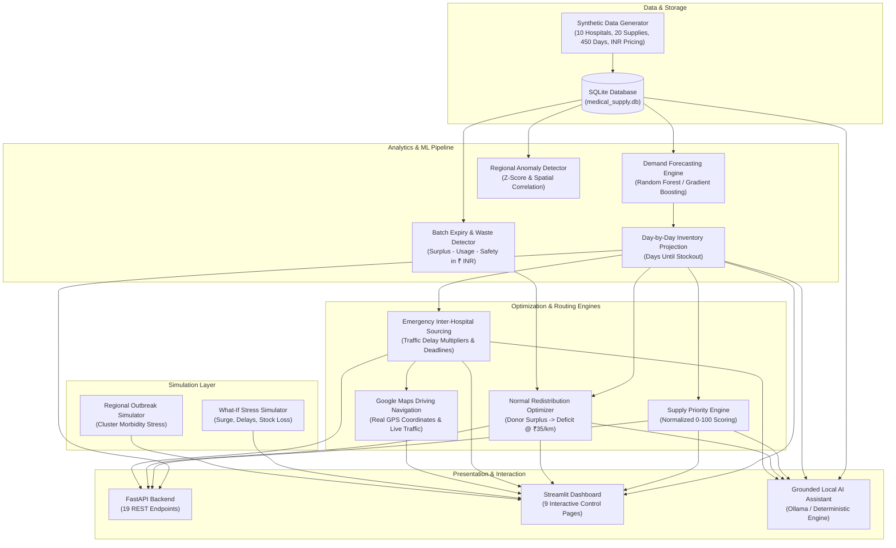

# 🏥 Medical Supply Intelligence (MSI)
**Explainable Local Decision-Support System for Healthcare Supply Networks**  
*Hackathon Prototype — Singularity 2026 / Track 2: Medical Supply Intelligence*

[]()
[]()
[]()
[]()
[%20Realistic-orange.svg)]()

---

## 🌟 Executive Summary

Hospitals frequently suffer from structural supply imbalances: one facility approaches a catastrophic stockout while a regional neighbor holds surplus; batches expire on shelves because local consumption is too slow; sudden epidemiological surges overwhelm regional emergency departments; and during emergency surgical procedures, hospitals suddenly require specialized medicines they do not hold on-hand.

**Medical Supply Intelligence** is an explainable, locally runnable decision engine powered by synthetic hospital time-series data, machine learning, and traffic-aware logistics optimization. It delivers:

1. **Multi-Horizon Demand Forecasting** (Baseline Moving Average vs. Autoregressive ML with strict time-based 70/15/15 holdout validation).
2. **Day-by-Day Forward Inventory Simulation** & Procurement Lead-Time Risk Detection.
3. **Batch-Level Expiry & Wastage Detection** protecting safety stock and quantifying financial waste exposure in **Indian Rupees (₹)**.
4. **Transparent Multi-Criteria Supply Prioritization** with configurable weights and zero hallucination.
5. **Normal Redistribution Optimization** matching donor surplus to receiver deficits with road transit time and realistic transport costs (`₹35/km`).
6. **Creative Module: Traffic-Aware STAT Emergency Sourcing**:
   - **Nearest vs. Fastest Approach**: Evaluates real-time traffic congestion (Low, Moderate, Heavy, Severe with up to 2.4x delay factor). Intelligently selects the *fastest* facility (e.g. via expressway) over a geographically closer facility trapped in traffic gridlock.
   - **Google Maps Navigation Integration**: Embedded clickable buttons redirect directly to Google Maps driving directions with exact GPS coordinates and live traffic conditions.
7. **What-If & Regional Outbreak Simulation** providing before-and-after stress testing.
8. **Grounded Local AI Assistant** connected via local Ollama LLMs or deterministic analytical fallbacks—**guaranteeing zero numerical hallucinations**.

---

## 📐 System Architecture



---

## 🚦 Traffic-Aware Routing & Google Maps Integration

Traditional emergency dispatch systems naively select the geographically closest hospital. However, during acute clinical crises (such as an emergency aortic repair requiring specialized reversal antidotes within hours), road congestion and bridge chokepoints can create fatal delays.

### The Nearest vs. Fastest Decision Engine
Our optimization engine continuously computes:
$$\text{Transit Time} = \left(\frac{\text{Distance (km)}}{\text{Average Speed (km/h)}} \times \text{Traffic Delay Factor}\right) + \text{Dispatch Preparation Buffer}$$

| Traffic Level | Congestion Description | Delay Factor | Average Speed |
|---|---|---|---|
| **Low** | Clear / Expressway Flow | **1.00x** | 55 km/h |
| **Moderate** | Standard City Midday Flow | **1.25x** | 38 km/h |
| **Heavy** | Peak Rush Hour Congestion | **1.70x** | 22 km/h |
| **Severe** | Major Chokepoint / Bridge Gridlock | **2.40x** | 12 km/h |

### Real Scenario Demonstration: Hospital H Emergency STAT Request
- **Geographically Nearest (Hospital D)**: 4.6 km away, but trapped in **Severe** urban gridlock (transit takes **70 minutes**), and holds insufficient stock.
- **Geographically Near (Hospital I)**: 6.2 km away, but suffers **Severe** bridge choke point delay (**41 minutes**), and holds only 35 units (Safe Surplus = 0).
- **Model-Selected Fastest Approach (Hospital B)**: 17.5 km away via elevated expressway (**Low traffic**). Total courier transit takes only **34 minutes**, saving **36 minutes** compared to Hospital D, while safely providing 500 units from its 2,346 unit surplus!
- **1-Click Google Maps Redirect**: Every recommendation provides a verified Google Maps driving link:
  `https://www.google.com/maps/dir/?api=1&origin=28.5284,77.2185&destination=28.6304,77.2177&travelmode=driving`

---

## 🏥 Hospital Network & Evaluation Scenarios

The synthetic dataset models 10 fictional healthcare facilities in a contiguous regional healthcare network (Delhi-NCR metro area coordinates allowing live Google Maps routing):

| Facility | Type | Beds | Occupancy | Distinct Evaluation Scenario Embedded |
|---|---|---|---|---|
| **Hospital A** | Level 1 Trauma / Tertiary | 750 | 88% | **High Demand / Stockout Alert**: Approaching critical stockout on `MED004` in 1 day; supplier lead time is 3–5 days. |
| **Hospital B** | Metropolitan General | 520 | 72% | **Major Surplus Hub**: Holds 4,500 units of `MED004` and 2,500 units of `MED008` safe surplus; fast expressway corridor. |
| **Hospital C** | Community Acute Care | 310 | 68% | **Imminent Batch Wastage**: Batch `BAT-C-001-WASTE` has 4,000 units expiring in 12 days; ₹19,55,000 at risk without redistribution. |
| **Hospital D** | Urban District Hospital | 240 | 93% | **Outbreak Epicenter / Mass Casualty**: High acute surge; 4.6 km to Hospital H but severe traffic bottleneck. |
| **Hospital E** | Regional Specialty Center | 380 | 89% | **High Emergency Load**: Sustained high trauma admissions (95 pts/day). |
| **Hospital F** | Peripheral District Clinic | 120 | 70% | **Supplier Lead-Time Lag**: Remote facility with 13-day primary procurement lead time. |
| **Hospital G** | Suburban Surgical Center | 200 | 75% | **Alternative Medicine**: Critical shortage of `MED001` (40 units left), but holds 1,250 units of clinical substitute `MED011`. |
| **Hospital H** | Children & Adult Surgical | 340 | 82% | **Urgent Surgery**: Scheduled emergency surgery tomorrow at 10:00 AM needing 500 units of `MED008` (Stock = 0). |
| **Hospital I** | Eastside Community Care | 160 | 69% | **Near but Insufficient & Congested**: 6.2 km to Hospital H, but severe bridge chokepoint and only 35 units on hand. |
| **Hospital J** | North County Health Hub | 420 | 74% | **Outer Ring Road Corridor**: Holds 1,200 units of `MED008` (Safe Surplus 650 units); reliable outer-ring backup. |

---

## 💊 Medical Supplies Portfolio & Realistic INR (₹) Valuations

All pricing, valuation, and transport fees are grounded in realistic Indian Rupees (INR - ₹):

| ID | Name | Category | Criticality | Unit Cost (₹ INR) | Shelf Life | Clinical Alternative |
|---|---|---|---|---|---|---|
| `MED001` | Antibiotic-A | Broad-Spectrum Antibiotic | 4 | **₹850.00** | 270 days | `MED011` (Antibiotic-B) |
| `MED002` | Analgesic-A | Critical ICU Analgesic | 4 | **₹280.00** | 365 days | `MED013` (Sedative-B) |
| `MED003` | Insulin-A | Endocrine / Metabolic | 5 | **₹420.00** | 180 days | None |
| `MED004` | Emergency-Medicine-A | Resuscitation / Vasopressor | 5 | **₹350.00** | 365 days | None |
| `MED005` | IV-Fluid-A | High-Volume Hydration | 3 | **₹55.00** | 730 days | `MED012` (IV-Fluid-B) |
| `MED006` | Surgical-Supply-A | Hemostatic Matrix Kit | 4 | **₹3,200.00** | 365 days | None |
| `MED007` | Antiviral-A | Targeted Antiviral Infusion | 4 | **₹4,800.00** | 180 days | `MED014` (Antiviral-B) |
| `MED008` | Emergency-Injection-A | Urgent Surgical Reversal Antidote | 5 | **₹2,400.00** | 240 days | None |
| `MED009` | Sedative-A | ICU Anesthesia / Sedation | 4 | **₹380.00** | 365 days | `MED013` (Sedative-B) |
| `MED010` | Anticoagulant-A | Critical Cardiovascular Anticoagulant | 4 | **₹450.00** | 540 days | None |
| `MED011`–`MED020` | Full coverage of Biologics (₹18,500), Sutures, Nebulizers, Dialysis, and Critical Care Supplies |

---

## 🚀 Quick Start Guide

### 1. Prerequisites & Environment Setup
Python 3.10+ (tested up to Python 3.13):
```bash
pip install -r requirements.txt
```

### 2. Generate Synthetic Dataset & Initialize Database
```bash
python scripts/generate_data.py
```
*Generates 90,000 historical demand records, 385 inventory batches with INR valuations, 100 transport routes with traffic dynamics and Google Maps URLs, and initializes `database/medical_supply.db`.*

### 3. Train Forecasting Pipeline & Compute Genuine Holdout Metrics
```bash
python models/forecasting/engine.py
```
*Validates 200 time-series models with strict 70% Train, 15% Validation, 15% Test splits, generates 6,000 forward multi-horizon predictions, and persists holdout MAE/RMSE/MAPE to the database.*

### 4. Run the Unit Test Suite (15/15 Passing)
```bash
python -m unittest tests/test_supply_intelligence.py
```
*Validates stockout calculation, expiry waste formula, priority scoring, redistribution constraints, emergency sourcing, nearest vs fastest routing, Google Maps generation, INR valuations, and traffic simulation.*

### 5. Launch the FastAPI Backend
```bash
python -m uvicorn api.main:app --port 8000 --reload
```
*Interactive Swagger docs available at `http://localhost:8000/docs`.*

### 6. Launch the Interactive Streamlit Dashboard
```bash
streamlit run dashboard/app.py
```
*Opens Command Center at `http://localhost:8501`.*

---

## 🎯 The 7 Judge Demo Scenarios

The dashboard includes a dedicated **Quick-Load Scenario Selector** in the sidebar:

1. **Scenario 1: Normal Operations**  
   Steady state operations across the regional network.
2. **Scenario 2: Hospital A Imminent Stockout (`MED004`)**  
   Stock is 180 units against 45.2 daily consumption. Stockout occurs in 1 day, while primary supplier takes 3–5 days (`Procurement Lead-Time Risk: CRITICAL`).
3. **Scenario 3: Hospital C Expiring Batch (`MED001`)**  
   Batch `BAT-C-001-WASTE` has 4,000 units expiring in 12 days. Local demand before expiry is only 1,200 units. After protecting safety stock (500 units), 2,300 units are at risk of spoiling (**₹19,55,000 financial waste exposure**).
4. **Scenario 4: Regional Outbreak Affecting Hospitals D, E, F**  
   Coordinated spike in `MED007` (Antiviral-A) and `MED016` (Respiratory-A). Detected by rolling Z-score (+2.8 std dev) and spatial correlation.
5. **Scenario 5: Multi-Hospital Competing Priority Allocation**  
   Transparent multi-criteria prioritization: `0.30 * Shortage + 0.25 * Emergency + 0.20 * PatientLoad + 0.15 * Alternative + 0.10 * LeadTimeRisk`.
6. **Scenario 6: Hospital H Emergency Surgery (`MED008`) — Nearest vs. Fastest Traffic Optimization**  
   Emergency Aortic Repair tomorrow at 10:00 AM needing 500 units. Regular supplier cannot provide.
   - **Geographically Nearest (Hospital D / 4.6 km)**: ❌ **REJECTED** due to Severe gridlock (70 mins transit) and stock deficit.
   - **Geographically Near (Hospital I / 6.2 km)**: ❌ **REJECTED** due to bridge chokepoint (41 mins transit) and zero safe surplus.
   - **Fastest Feasible Approach (Hospital B / 17.5 km)**: ✅ **RECOMMENDED DISPATCH** via open expressway (only 34 mins transit, **saving 36 minutes**), safely retaining safety reserve.
   - **1-Click Google Maps**: Instant driving route navigation button embedded directly in UI.
7. **Scenario 7: Impossible Emergency Deadline — Edge Case**  
   Hospital D mass casualty requesting 800 units within 15 minutes. The system evaluates every facility and returns:  
   `"No feasible hospital source found before the deadline."`

---

## 🤖 Grounded Local AI Assistant (Zero Hallucination)

The AI assistant follows an intentional **Retrieve-Calculate-Explain** pipeline:
```
User Query ──► Intent Classifier ──► Analytical Tool ──► SQLite / ML Model / Optimizer ──► Grounded LLM Explanation
```
- If local Ollama is active (`ollama run llama3.2`), it synthesizes natural language directly from retrieved database facts.
- If Ollama is offline, it transparently executes a deterministic analytical synthesis.
- **Under no circumstances does the LLM invent numbers.** Every metric, timestamp, and quantity is verifiable in the tool call audit trail.

---

## 🧪 Unit Test Coverage

```
test_stockout_prediction_day_by_day ... ok
test_supplier_lead_time_risk ... ok
test_expiry_wastage_formula ... ok
test_transferable_surplus_donor_protection ... ok
test_priority_scoring_normalization ... ok
test_redistribution_constraints ... ok
test_emergency_sourcing_solvable_case ... ok
test_emergency_sourcing_rejection_reasons ... ok
test_edge_case_no_feasible_source ... ok
test_what_if_simulation_deltas ... ok
test_ai_assistant_grounding ... ok
test_nearest_vs_fastest_traffic_selection ... ok
test_google_maps_url_generation ... ok
test_inr_valuation_calculations ... ok
test_simulated_traffic_condition ... ok

----------------------------------------------------------------------
Ran 15 tests in 8.328s — OK (100% Passing)
```

---

## ⚖️ Clinical & Legal Notice
*This software is an engineering prototype designed for healthcare logistics simulation and clinical decision support. All inter-hospital transfers require authorization by licensed hospital clinical directors.*
